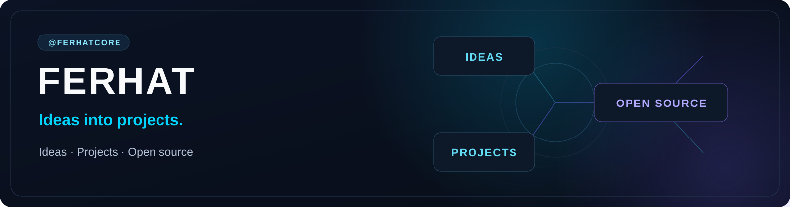

  

  
  
  

---

## About Me

Mobile Software Engineer based in London, working with React Native and TypeScript. My background includes fintech, mobile payments and native development with Kotlin and Swift.

Founder and sole developer of **VocaScene**, and co-founder and mobile developer of **OddsRadar**. I also build developer tools and work on **EMusica**, a TypeScript and MCP project for Ableton Live.

---

## Products

| Product | Focus |
| --- | --- |
|  | Language learning through vocabulary and subtitle context from streaming content. |
|  | Football match data, odds movements and alerts. |

---

## Agent Workflows

### [Project OS for Claude Code and Codex](https://github.com/ferhatcore/claude-codex-project-os)

Shared task files, development roles and QA checks for **Claude Code and Codex**.

[Explore the repository →](https://github.com/ferhatcore/claude-codex-project-os)

---

## Tools & Platforms

Main tools used across my projects.

| Area | Tools |
| --- | --- |
| **AI & workflows** | Claude Code · Codex · OpenAI API |
| **Languages & runtime** | TypeScript · JavaScript · Swift · Kotlin · Python · Java · Node.js |
| **Web & extensions** | React · Next.js · Tailwind CSS · WXT |
| **Mobile** | React Native · Expo |
| **Data & integrations** | Supabase · PostgreSQL · Stripe · Azure Speech |
| **Interface & animation** | shadcn/ui · Radix UI · Rive · Three.js |
| **Testing & quality** | Jest · React Native Testing Library · Node.js test runner · ESLint · Prettier |
| **Delivery** | Git · GitHub Actions · pnpm |

---

## Focus

Mobile development · Fintech · Developer tools

